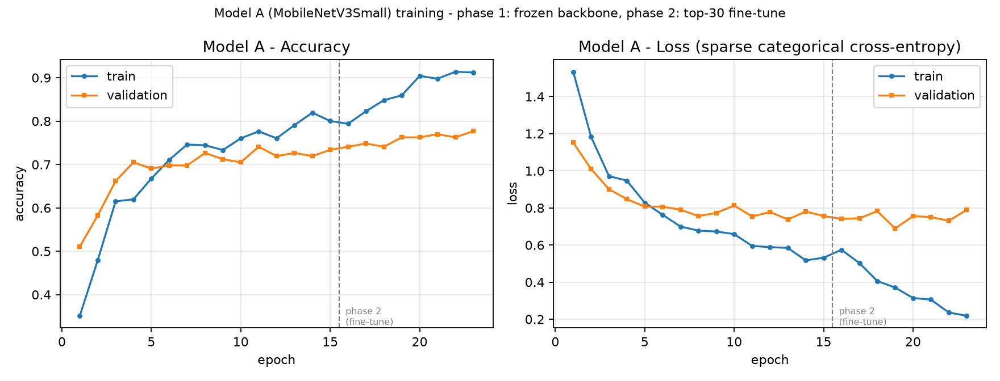
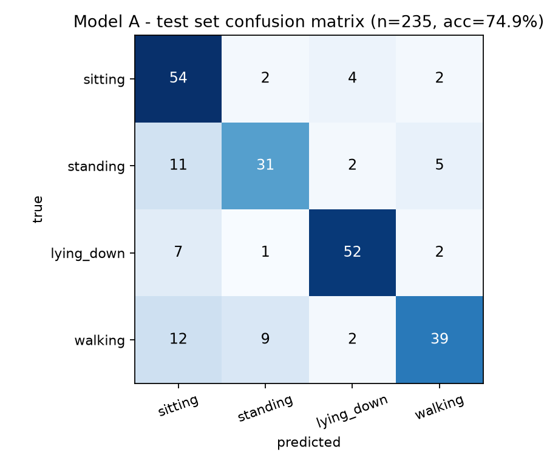

# Testing Documentation — Dog Training Assistant (CS663 Project 2, Group 5)

Every number below was produced by running the code in this repository or the
deployed backend (the on-device section: GitHub B's app and its `eval/` scripts), on held-out data the models were not trained on. Splits are
by source (dog/session), never by random shuffle: a dog in the test set never
appears in training.

## Results summary

| Component | Test | Result |
|---|---|---|
| Model A (MobileNetV3Small, student fine-tuned, dataset v4) | 235 held-out images | **74.9% accuracy** (176/235); val 77.7% |
| Model B (Gemini, fine-tuned, dataset v3) | 43 held-out images | **tuned 88.4%** vs base 86.0% |
| Model C+ (YOLOv8n, COCO pretrained) | 60 held-out v4 photos | dog detected in **81.7%** (49/60) |
| Model C+ (YOLOv8n) | 111 video-sequence frames | dog detected in **58.6%** (65/111) |
| Temporal layer (state machine) | 42 Python unit tests (app rules, incl. the 21 app tests ported) + 21 Java tests in the app | **42/42 and 21/21 pass** |
| Temporal layer | 6 real-video sequences (labels mode) | **6/6 expected verdicts** |
| Temporal layer | 6 synthetic scenarios | **6/6 expected verdicts** |
| Temporal layer, live | seq06 frames via deployed tuned endpoint | verdict **UNCERTAIN**, matches expected |
| Model C on the phone (EfficientDet-Lite0, COCO int8; GitHub B) | 111 video-sequence frames, widened accept rule | dog found in **96%** (dog/cat only: 61%) |
| Model A input, whole frame vs Model C crop (GitHub B) | 235 held-out images | whole **75.3%** vs crop (pad 0.15) 68.5% |
| Temporal layer, Java `SequenceSession` (GitHub B) | 21 unit tests | **21/21 pass** |
| Full system on the Android emulator (all three models, replay) | 5 attempts on project clips | 4 of 5 reached the expected verdict; seq01 Stand never started (Model A miss) |
| On-device latency, Model C + A (emulator only) | 4 full attempts | median **94–149 ms/frame**, p90 128–335 ms; no physical phone yet |

## Model A — curves and metrics

Training/validation accuracy and loss curves (two training phases marked):

Confusion matrix on the 235-image test set:

Per-class (test): lying_down F1 0.853 (P 0.867 / R 0.839) · sitting F1 0.740 ·
walking F1 0.709 · standing F1 0.674. Full metrics: `model-a/metrics.md`,
raw history: `model-a/history.json`, all 235 predictions:
`model-a/test_predictions.json`. The deployable export is `model-a/model_a.tflite`
(float16, verified to load and agree with the Keras model). The app in GitHub B
now runs this file on the phone (a byte-identical copy); see On-device pipeline below.

## Model B — fine-tuned Gemini

On the v3 test set (43 images, same prompt and splits for both models):
base Gemini 37/43 = **86.0%**, fine-tuned Gemini 38/43 = **88.4%**; the gain is
in lying down (tuned 14/14). Full results in `gemini-finetune/` (results and
per-image outputs from the original exercise). The tuned endpoint is live in
the deployed backend. The v1 app was built to call it on every frame at 1 fps
(~3.5 s per call, measured in the Nov 11 harness). The current app (GitHub B) no longer does: it re-checks the 2–3 decisive
frames after the verdict (VERIFIED / DISPUTED / PARTLY CHECKED / NOT CHECKED) and
is asked to break a READY tie when Model A has been unsure for 2 s (at most
once every 6 s).
Dataset v4 (1,000 images) is collected and verified for the next tuning round
(`gemini-finetune/real-data-v4/`); the deployed tuned model is still the v3 one.
The Model B sequence-advice corpus (180 synthetic scenarios, every verdict
machine-checked against the state machine) is in
`gemini-finetune/model-b-scenarios/`.

## Model C+ — YOLOv8 detection

Full report with every failure filename: `model-c/results.md`.
Detection is reliable on upright, well-framed dogs (sitting 94% on held-out
photos) and weak on lying/curled/top-down views — the worst case is the Batumi
lying sequence at 3/20 frames (dark pavement, portrait orientation). 12 images
contain a second dog with its own box, so a consumer must pick one box to
track. This is why the v1 live pipeline judged posture from full frames with the
Gemini models and why the temporal layer treats missing/unclear frames
explicitly instead of guessing. YOLOv8n stays the offline evaluation. The
detector on the phone in GitHub B is a different one, EfficientDet-Lite0
(MediaPipe ships it ready for Android), with its own recall check in
On-device pipeline below; posture there comes from Model A on the full frame.

## Temporal layer

- Unit tests: `video-sequence-layer/test_state_machine.py` — 42 tests (Nov 25):
  the original 17 (settle grace, smoothing, the sustained-break rule, lost-dog
  and low-quality UNCERTAIN paths, progress reporting), the app's 21 tests
  ported one to one, and 4 configuration tests. All pass. The Nov 11 rules
  are kept in `state_machine_nov11.py` (`--rules nov11`).
- Real sequences: 6 clips cut from real dog videos with human-verified labels
  (5 sustained holds → SUCCESS, 1 short clip → UNCERTAIN incomplete). All 6
  judged as expected. Raw run: `video-sequence-layer/results/verification_run.txt`.
- Live proof: seq06's 7 frames sent to the deployed tuned endpoint; all
  classified standing; the state machine returned UNCERTAIN (clip ended; held time is time-base dependent: 3.0s at the stored 2 fps, 6.0s at the 1 fps the app used then - see video_evaluation.md) — `video-sequence-layer/results/live_seq06_tuned.json`.

## 16 unique test cases

TC-01 to TC-10 were run offline or against the backend; TC-11 to TC-16 were added
Nov 25 from GitHub B (TC-11 to TC-15 on the Android emulator, not a phone).

| # | Case | Setup | Expected | Actual | Evidence |
|---|---|---|---|---|---|
| TC-01 | Model A, sitting, clean photo | Held-out test image, unseen source | sitting | sitting, conf 0.999 | `model-a/sample_predictions.md` #1 |
| TC-02 | Model A, lying down | Held-out test image | lying_down | lying_down, conf 1.000 | `model-a/sample_predictions.md` #6 |
| TC-03 | Model A, walking mid-stride | Held-out test image | walking | walking, conf 1.000 | `model-a/sample_predictions.md` #8 |
| TC-04 | Model A, hard case — sitting called walking | Held-out test image where posture is ambiguous in one frame | sitting | **walking, conf 0.991 (miss)** | `model-a/sample_predictions.md` #3 |
| TC-05 | Model A, hard case — standing called lying down | Held-out test image | standing | **lying_down, conf 0.968 (miss)** | `model-a/sample_predictions.md` #5 |
| TC-06 | Fine-tuned vs base Gemini, same test set | v3 43-image test, identical prompt | tuned ≥ base | tuned 88.4% vs base 86.0% | `gemini-finetune/` results |
| TC-07 | YOLO on upright held-out photos | 60-image v4 test sample | dog found in most | 49/60 = 81.7% (sitting 94%) | `model-c/results.md` |
| TC-08 | YOLO failure mode — lying dog, top-down, dark ground | Batumi sequence, 20 frames | dog found | **3/20** — documented failure mode | `model-c/results.md`, `model-c/examples/ex6_*` |
| TC-09 | Full sequence judged SUCCESS | Real clip, dog lying 10s, target lying down 8s | SUCCESS | SUCCESS — held the full 8s | `video-sequence-layer/results/verification_run.txt` (seq02) |
| TC-10 | Live end-to-end: real frames through deployed tuned model | seq06 wagging clip (3.6s) vs 8s target, live backend mode | UNCERTAIN (too short to succeed, not a break) | UNCERTAIN — clip ended (held 6.0s of 8s at the 1 fps time base the app used then; 3.0s at the stored 2 fps) | `video-sequence-layer/results/live_seq06_tuned.json` |
| TC-11 | Emulator, full system: Stay held | seq02 replay (dog lying, holds), Stay lying down 5 s, all three models, live backend | SUCCESS | SUCCESS — reached 0.5 s, held 5.0 s; Model B VERIFIED 2/2; 94 / 166 ms/frame | GitHub B README Section 3 (branch `app-three-model-integration`) |
| TC-12 | Emulator, full system: Stay held, panting dog | seq05 replay, Stay lying down 5 s | SUCCESS | SUCCESS — reached 0.5 s, held 5.0 s; Model B VERIFIED 2/2; 114 / 128 ms/frame | GitHub B README Section 3 |
| TC-13 | Emulator, full system: Walk | seq03 replay (dog walking), Walk 5 s | SUCCESS | SUCCESS — held 6.5 s; Model B VERIFIED 2/2; 102 / 138 ms/frame | GitHub B README Section 3 |
| TC-14 | Emulator, full system: broken Stay (constructed clip) | Splice: seq05 lying → seq01 standing, Stay lying down 5 s | EARLY_BREAK | EARLY_BREAK at 1.5 s, held 1.0 s; Model B VERIFIED 3/3; 149 / 335 ms/frame | GitHub B README Section 3 |
| TC-15 | Emulator, full system: Stand, africanis dog | seq01 replay (dog standing), Stand | READY opens, attempt judged | **Never started — READY never opened (miss)**: Model A reads the standing dog as sitting at 91–99% | GitHub B README Section 3 |
| TC-16 | Model C accept rule, africanis clip | seq01, 20 frames, all contain a dog; EfficientDet-Lite0 as on the phone | dog found in most | dog/cat only 15%; widened rule **95%** | GitHub B `eval/model_c_recall_results.md` |

The EARLY_BREAK path is covered by the synthetic scenario suite (scen02:
dog leaves sitting after 2.5s of a 5s target (raw break at t=2.5s, confirmed t=4.0s) → EARLY_BREAK with the held time
reported; 6/6 scenarios pass with `--rules nov11`) and by 6 of the original 17 unit tests. It is synthetic
because none of the licensed real clips contain a genuine break; no posture
change was edited into a real clip. TC-14 (Nov 25, emulator) is the first break
run through the real models, on a clip constructed by joining frames of two real
clips (seq05 lying, then seq01 standing). It is not a genuine break either.

## End-to-end video evaluation

Added 2026-11-11. The labels-mode results above check the judging logic
(human labels in, verdict out). This section is the full pipeline: the
actual video frames through the actual classifiers, judged by the state
machine. Full write-up:
`video-sequence-layer/results/video_evaluation.md`.

| Sequence | Expected | Model A verdict | Tuned verdict |
|---|---|---|---|
| seq01 standing, Africanis | SUCCESS | **UNCERTAIN** (never established) | SUCCESS |
| seq02 lying, Batumi | SUCCESS | SUCCESS | SUCCESS |
| seq03 walking, Mission | SUCCESS | SUCCESS | SUCCESS |
| seq04 lying, Snoring | SUCCESS | SUCCESS | SUCCESS |
| seq05 lying, Panting | SUCCESS | SUCCESS | SUCCESS |
| seq06 standing, Wagging (short) | UNCERTAIN | UNCERTAIN (never established) | UNCERTAIN (held 6.0s of 8s) |

- **Model A:** attempt-level **5/6 (83.3%)**, frame-level **82/111
  (73.9%)** — the same accuracy as its test set, and the same failure:
  it cannot see standing in these clips. All 20 seq01 frames were
  called sitting (conf 0.77–0.95) and all 7 seq06 frames walking
  (tail-wag reads as gait). Smoothing cannot fix a classifier that is
  wrong on every frame. Note seq06's Model A verdict matches only in
  letter: it failed at the settle grace, not on the incomplete hold.
- **Tuned Gemini (live):** attempt-level **6/6 (100%)**, frame-level
  **110/111 (99.1%)** — one miss (seq03 frame_019, walking called
  standing), smoothed away. 0 failed calls and 0 unparseable replies
  in 111 calls, but ~3.5 s per call, so the app's 1 fps sampler at the
  time could not keep up in wall-clock time (verdicts count frames, not
  wall clock).
- **Time base, stated plainly:** stored frames are 2 fps; this run fed
  them at t = frame index (1 fps, matching the app at the time), not at the
  labels-mode t = i/2. A 10 s clip is therefore a 20 s machine interval
  here, which makes SUCCESS easier to reach than in the labels-mode
  check, and gives each classifier twice as many frames as a live
  attempt of the same clip would. Both classifiers were fed identical
  streams at the identical time base, so the comparison between them
  stands; the absolute verdicts are app-equivalent, not real-time.
- No EARLY_BREAK occurred in either run — no clip contains a genuine
  break. The break path is still proven only synthetically (scenarios +
  unit tests).
- **What this run was:** the Python state machine
  (`video-sequence-layer/state_machine.py`, the Nov 11 rules, fed t = frame
  index, i.e. 1 fps), as
  the app worked on Nov 11. The app has since moved to on-device Model C + A
  and a time-based Java state machine (next section). These numbers stay
  valid for what they measured.

## On-device pipeline (GitHub B, Nov 25, emulator)

Added 2026-11-25. This is the issue #7 work: per-frame inference moved onto
the phone. Code and evaluation scripts are in GitHub B, branch
`app-three-model-integration` (pushed, **not yet merged to main**); its README
Section 3 and `eval/` are the source of every number here.

What replaced the v1 live loop (Camera2 at 1 fps, each frame a ~3.5 s cloud
call to tuned Gemini):

- **Model C on the phone:** EfficientDet-Lite0 (COCO, int8) via MediaPipe
  Tasks. This is a different detector from the YOLOv8n evaluated offline in
  `model-c/` above; both are pretrained COCO detectors, not fine-tuned. Accept
  rule: COCO "dog" ≥ 0.25, or cat/horse/sheep/cow/bear ≥ 0.30, because
  EfficientDet often labels real dogs as other four-legged animals.
- **Model A on the phone:** `model_a.tflite` (byte-identical to
  `model-a/model_a.tflite`) via LiteRT, 224×224 RGB 0–255, on the whole frame,
  counted only on frames where Model C found a dog.
- **Frame rate:** the analysis loop is capped at ~5 fps (180 ms minimum frame
  interval), the proposal's rate, instead of 1 fps.
- **State machine:** the Java `SequenceSession`, time-based (seconds, any fps):
  majority of the last 5 confident frames, 0.65 confidence gate, 2 s settle
  grace, a break must persist 0.6 s, >1.5 s lost/unclear → UNCERTAIN, 3 s
  response window for Sit/Down (Stand, Stay and Walk use the 2 s settle grace),
  0.6 s hold after reach. 21 unit tests, 21/21 pass. The Python
  `video-sequence-layer/state_machine.py` follows the same rules since Nov 25
  (42/42 tests); the Nov 11 rules are kept in `state_machine_nov11.py`.
- **Gemini off the per-frame path:** Model B (tuned Gemini) re-checks 2–3
  decisive frames after the verdict and breaks READY ties; base Gemini writes
  the coaching tip and is told not to re-judge.

**Emulator only.** Measured on the Android emulator on an Apple-silicon Mac
(Pixel 10 Pro system image, arm64, Android 37, 16 KB pages), against the live
Cloud Run backend, with the debug replay mode feeding the project clips at
their stored 2 fps. **Not measured on a physical phone yet.** The emulator's
live camera reached only ~1.1–1.6 analysed fps (emulator CPU load, System UI
ANRs), which says nothing about a phone. Real-phone fps and latency come with
the demo (issue #2).

### Full system, one attempt per row (all three models)

| Clip | Command | Verdict | Timing | Model B check | On-device ms/frame (median / p90) |
|---|---|---|---|---|---|
| seq02 (dog lying, holds) | Stay: lying down, 5 s | **SUCCESS** | reached 0.5 s, held 5.0 s | VERIFIED 2/2 | 94 / 166 |
| seq05 (dog lying, panting) | Stay: lying down, 5 s | **SUCCESS** | reached 0.5 s, held 5.0 s | VERIFIED 2/2 | 114 / 128 |
| seq03 (dog walking) | Walk, 5 s | **SUCCESS** | held 6.5 s | VERIFIED 2/2 | 102 / 138 |
| splice: seq05 lying → seq01 standing | Stay: lying down, 5 s | **EARLY_BREAK** at 1.5 s | held 1.0 s | VERIFIED 3/3 | 149 / 335 |
| seq01 (dog standing) | Stand | never started | READY never opened | — | — |

- **Latency:** per-frame on-device time (Model C + Model A + crop, from the
  app's log) over the 4 full attempts: median 94, 102, 114, 149 ms; p90
  128–335 ms. That is under the proposal's 300 ms median target **on the
  emulator**, against ~3.5 s per frame in the v1 loop. Model B calls took
  2.7–4.8 s each and coaching 3.1–8.4 s; both run after the verdict, not per frame.
- **The splice is a constructed clip** (frames of two real clips joined), not a
  real break. The verdict is right because the dog leaves lying down either way.
- **The seq01 failure is real:** Model A reads the standing africanis dog as
  sitting at 91–99%, so READY (which needs the dog standing first) never opens.
  This is the same Model A miss as in the Nov 11 run (all 20 seq01 frames called
  sitting). The state machine cannot fix a confident wrong label.

### Model C recall on the phone's detector (`eval/model_c_recall_results.md`)

Dog found per frame, 6 project clips, 111 frames, all contain a dog. Old rule =
COCO dog/cat only; new rule = the four-legged accept rule above.

| Clip | Frames | Old rule (dog/cat) | New rule (4-legged) |
|---|---|---|---|
| seq01_stand_africanis | 20 | 15% | 95% |
| seq02_down_batumi | 20 | 85% | 95% |
| seq03_walk_mission | 24 | 67% | 96% |
| seq04_down_snoring | 20 | 60% | 95% |
| seq05_down_panting | 20 | 70% | 100% |
| seq06_stand_wagging_short | 7 | 86% | 100% |
| **All** | 111 | 61% | 96% |

### Model A input: whole image vs Model C crop (`eval/model_a_crop_vs_full.md`)

Same detector, accept rule, crop math and Model A file as the app. Accuracy is
top-1 over 4 classes; "confident" = softmax ≥ 0.65, the app's threshold.
Images where Model C found no dog use the full-frame answer in every column.

Held-out test photos (Model A test split): 235 images, Model C found the dog in 223 (95%).

| Model A input | Accuracy | Confident (>=0.65) | Accuracy when confident | lying_down | sitting | standing | walking |
|---|---|---|---|---|---|---|---|
| whole image | 75.3% | 85% | 80.5% | 53/62 | 52/62 | 29/49 | 43/62 |
| Model C crop, pad 0.15 | 68.5% | 80% | 75.4% | 55/62 | 54/62 | 35/49 | 17/62 |
| Model C crop, pad 0.35 | 70.2% | 83% | 76.3% | 54/62 | 54/62 | 31/49 | 26/62 |
| Model C crop, pad 0.6 | 73.2% | 86% | 78.7% | 53/62 | 53/62 | 30/49 | 36/62 |
| mean of whole image + crop 0.15 | 74.9% | 75% | 81.2% | 53/62 | 55/62 | 32/49 | 36/62 |

Video clip frames (clip label applied to every frame): 111 images, Model C found the dog in 107 (96%).

| Model A input | Accuracy | Confident (>=0.65) | Accuracy when confident | lying_down | standing | walking |
|---|---|---|---|---|---|---|
| whole image | 73.9% | 99% | 73.6% | 60/60 | 0/27 | 22/24 |
| Model C crop, pad 0.15 | 62.2% | 92% | 64.7% | 60/60 | 4/27 | 5/24 |
| Model C crop, pad 0.35 | 65.8% | 92% | 66.7% | 59/60 | 1/27 | 13/24 |
| Model C crop, pad 0.6 | 71.2% | 96% | 72.0% | 60/60 | 0/27 | 19/24 |
| mean of whole image + crop 0.15 | 71.2% | 83% | 71.7% | 60/60 | 0/27 | 19/24 |

- This is why the app gives Model A the whole frame and uses Model C as a gate
  (no dog → frame not judged), not as a crop source for Model A.
- 75.3% here vs the stored 74.9% (sanity check in the script: 0.7489): same
  model, different resize library (PIL bilinear in this re-run vs the training
  pipeline). Both are reported as measured.

## Known limitations (also in GitHub B, Section 4 on branch `app-three-model-integration`)

- All imagery is licensed stock, not the group's own dogs; breed and viewpoint
  coverage is uneven (standing is show-photo heavy; two gait sequences are
  Muybridge-style).
- Single-frame posture is ambiguous between standing/sitting/walking — the
  measured confusion pattern — which is the reason the system judges sequences,
  not photos.
- YOLOv8n under-detects lying and curled dogs. It is the offline evaluation
  only and is not in the app. The phone runs EfficientDet-Lite0 as Model C, and
  there it is a gate (no dog → frame not judged); with the widened accept rule
  it found the dog in 96% of clip frames, but a cat or other pet in view could
  also be taken as "the dog".
- The current app (GitHub B, branch `app-three-model-integration`, not yet
  merged to main) has run end to end only on the Android emulator, in replay
  mode (Nov 25, section above), plus 21/21 Java unit tests. It has not run on a
  physical phone. On-device latency is emulator-measured; real-phone fps and
  latency come with the recorded demo (issue #2, GitHub B Section 5).
- Model A misreads the standing africanis dog as sitting (91–99%), so a Stand
  attempt with that dog never opens READY (TC-15).
